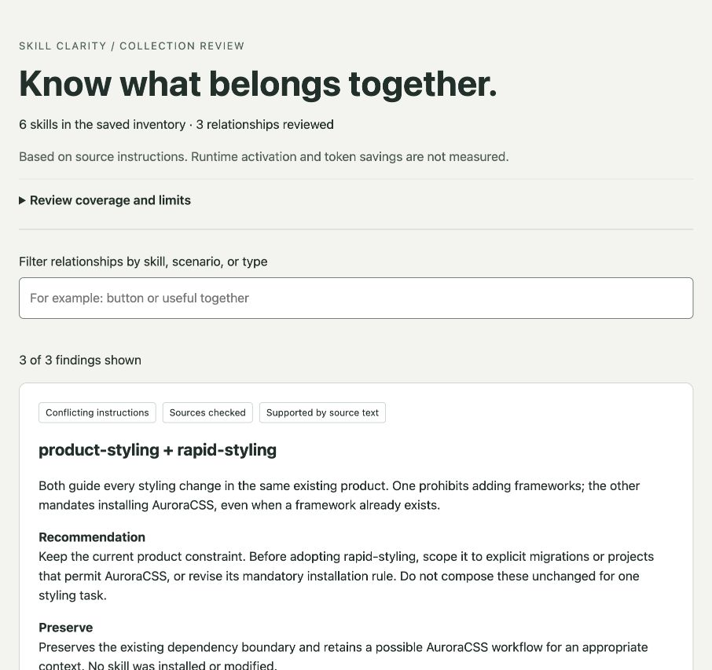
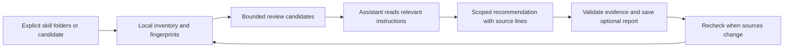

# Skill Clarity

**Know what your skills add, where they compete, and what to keep.**

An open-source skill for reviewing a collection of agent skills. It explains overlapping triggers and incompatible instructions with source evidence, preserves useful complements, and checks whether saved decisions are still current after a change.

**v0.1 · experimental.** The local helpers need Python 3.10+ and no third-party packages. Semantic review uses your existing assistant; it does not require an additional model service. Your assistant's normal usage costs still apply.



## Why this exists

This started with a messy collection of design skills from different creators. Each looked useful when installed. Together, it became hard to tell what each one added, which instructions overlapped, and which should guide a particular project. The founder built an Obsidian map just to understand the collection.

That experience appears in public discussions too: people ask which overlapping skills to keep and whether stacking them helps. But **similar does not mean redundant**, and **installed does not mean invoked**. Deleting by keyword overlap can remove the one check you needed.

Skill Clarity turns that uncertainty into a scoped decision:

> These two skills can guide the same screen, but one requires preserving its existing component system while the other requires replacing it. Here are the exact instructions. Keep the first for product maintenance and scope the second to deliberate redesigns. Both retain a useful role.

See the [evidence and existing alternatives](docs/evidence.md). This project does not claim to be the first skill auditor or to save a measured percentage of tokens.

## Use it

Copy `skills/skill-clarity/` into a skill directory supported by your assistant. Common local locations include `~/.agents/skills/` and a project's `.claude/skills/`; follow your client's discovery rules. Preserve any existing installation instead of copying over it blindly. No scripts need to run during installation.

If you already use the Skills CLI, install just this skill:

```sh
npx skills add julianrojas1011/skill-clarity --skill skill-clarity
```

For a local checkout, replace `julianrojas1011/skill-clarity` with `.`. Then ask your assistant:

- **Collection:** “Use skill-clarity to review the skills in this folder. Explain which compete and which should stay together.”
- **Before adding:** “Compare this candidate skill with my installed collection before I adopt it.”
- **After updating:** “Review what changed using the previous scan and decisions. Don't repeat unchanged advice.”
- **One problem:** “These two design skills seem to disagree. Show where and explain when each should apply.”

The skill is discoverable for skill-management requests. It does not install a watcher or a mandatory audit on every ordinary task. Automatic selection and filesystem access depend on the host. Without file access, it can review supplied text but cannot verify the local inventory.

## What it does

| Question | Result |
|---|---|
| What is here? | Canonical sources, aliases, metadata, references, and change fingerprints. Runtime availability stays unknown unless separately evidenced. |
| What might compete? | A bounded queue for review. Similarity is a retrieval hint, not a verdict. |
| Where do instructions disagree? | An assistant interpretation with the shared scenario, exact source lines, uncertainty, and preserved capabilities. |
| Can these work together? | Distinguishes complementary stages, contextual alternatives, prerequisites, and genuine contradictions. |
| Is the old advice still current? | Rechecks source fingerprints and citations; changed resources invalidate saved evidence. |
| Can I see the relationships? | An optional offline HTML report with filtering and expandable source evidence. No Obsidian or server required. |

Open the [synthetic example report](docs/demo.html) locally to explore three reviewed relationships. GitHub displays HTML source; download the repository and open the file in your browser.

## How it works



Scripts handle filesystem facts; your assistant interprets meaning. The scanner does not call a model, use the network, or execute discovered skills. Source files are inspection data, including any instructions that try to influence the auditor.

The first scan still reads and fingerprints files. Later reviews can reuse unchanged semantic decisions. That is an efficiency mechanism, **not evidence of net token savings**. The report separates rough text size from actual runtime usage.

## Run the helpers directly

From the repository root, with generated files outside the inspected collection:

```sh
python3 skills/skill-clarity/scripts/scan.py scan /path/to/skills --output .skill-clarity/scan.json --state .skill-clarity/state.json
python3 skills/skill-clarity/scripts/scan.py scan /path/to/skills --candidate /path/to/new-skill --output .skill-clarity/candidate.json
```

`--output` prints only a compact summary; the complete inventory stays in the file. Ask your assistant to inspect relevant entries rather than paste the whole inventory into context. Without `--output`, the scanner emits full JSON for pipelines.

For a saved semantic review authored by the assistant:

```sh
python3 skills/skill-clarity/scripts/review.py validate --scan .skill-clarity/scan.json --review .skill-clarity/review.json
python3 skills/skill-clarity/scripts/review.py render --scan .skill-clarity/scan.json --review .skill-clarity/review.json --format html --output .skill-clarity/report.html
```

The [workflow reference](skills/skill-clarity/references/workflow.md) documents the review format, exit codes, scope, and limitations. Validation checks attribution and freshness, not whether the assistant's interpretation is correct. Reports are point-in-time artifacts, not live monitors.

## Evidence so far

The [evaluation record](docs/evaluation.md) includes filesystem tests, original behavioral fixtures, and a comparison with a plain audit prompt. Both independent agents reached the correct core recommendation in all 11 small synthetic cases. This does **not** demonstrate semantic superiority, real-world accuracy, or token savings.

The useful engineering guarantees tested here are narrower: preserve inspected files, distinguish aliases, bound work, detect changed references, reject invented source citations, and keep untrusted markup inert. A separate end-to-end exercise generated the example report from three fixtures.

```sh
python3 -m unittest discover -s tests -v
```

## Limits that matter

- It cannot intercept every external installation or enforce a host's runtime skill selection.
- An on-disk inventory may contain inactive plugins or miss account-managed skills. It must be reconciled with the host when possible.
- Lexical shortlisting can miss related skills with different wording. Explicit user concerns must still be inspected. Coverage counts remain visible.
- The scanner supports common scalar frontmatter, not all YAML. Unsupported syntax is reported rather than silently interpreted.
- Local helpers make no network requests; excerpts read by an online assistant are still processed by that provider. Saved scans may contain private paths and metadata.
- It does not delete, merge, disable, or rewrite your collection automatically. A fix needs a concrete scope and preserves the user's existing authorization.

## Contribute a case, not just another feature

The most useful contribution is a small, redacted reproduction: the relevant skill instructions, a realistic request, what should coexist, and what went wrong. Include a complement or conditional exception that could disprove your suspected conflict. Never submit secrets or someone else's private skills.

For code changes, add a behavioral regression and run the tests. For instruction changes, test a fresh agent without revealing the expected answer. Keep the entrypoint short and move conditional detail into references. Publish failures as well as successes; do not infer savings from file counts or text-length estimates.

See [v1 scope and engineering decisions](docs/v1-plan.md). Future integrations should be driven by demonstrated failures, not a larger feature checklist.

[MIT license](LICENSE).
